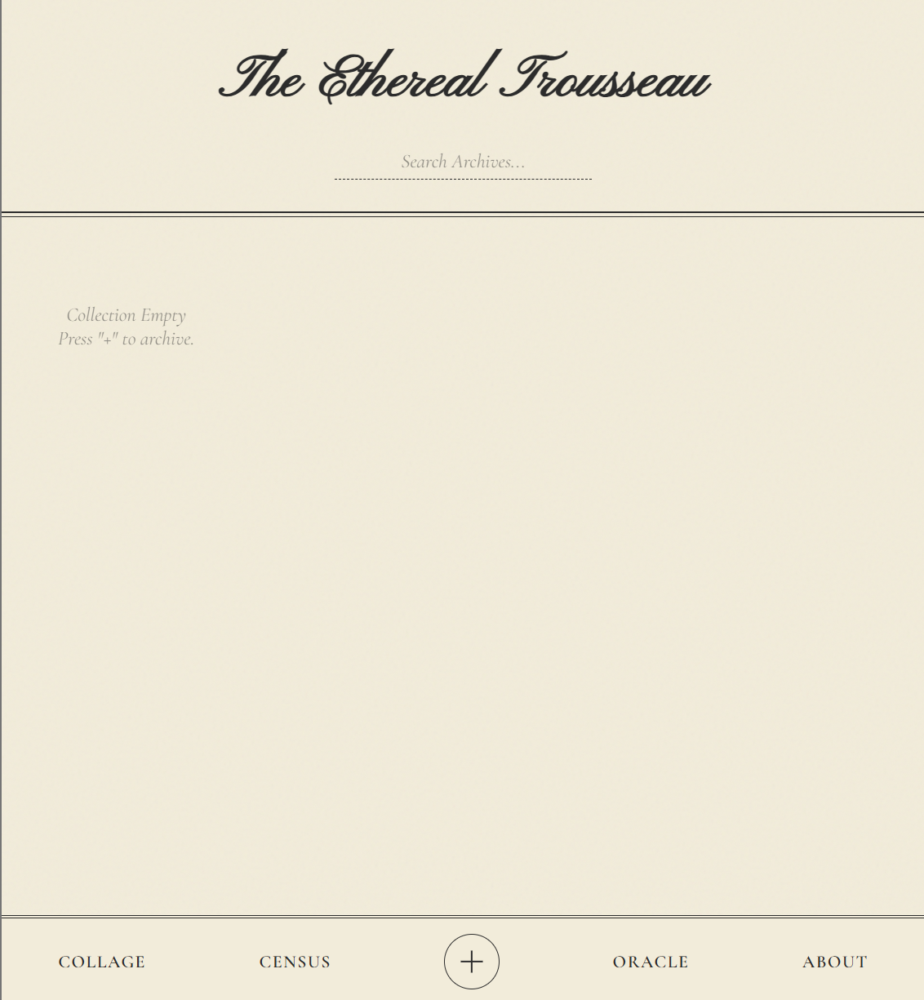
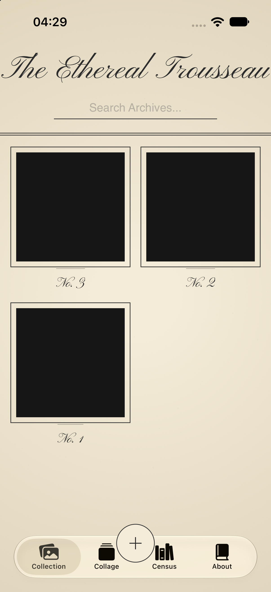
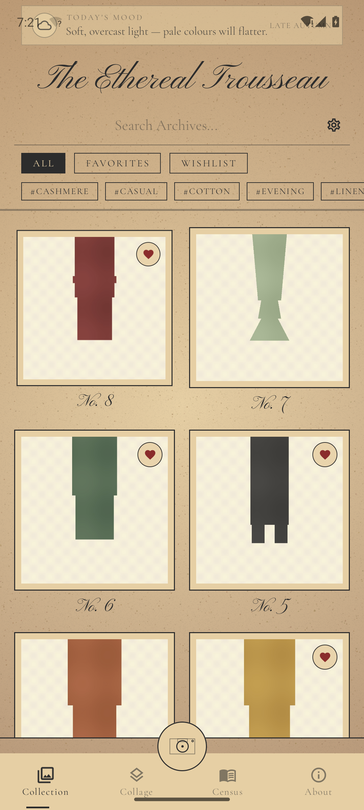
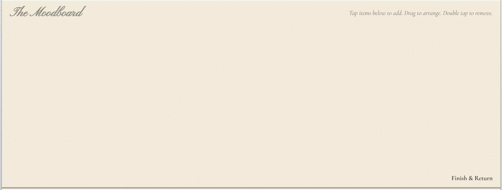
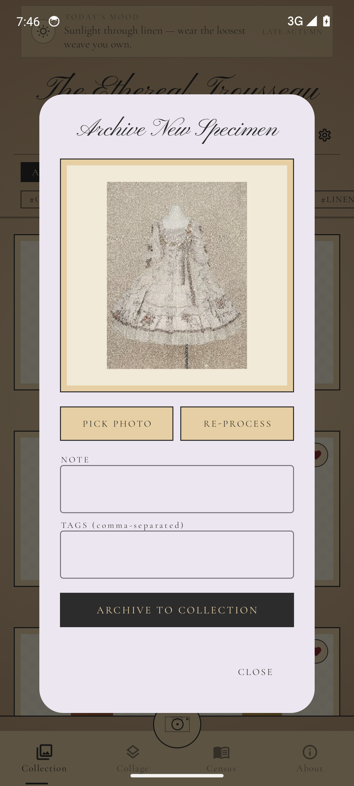

<div align="center">

# The Ethereal Trousseau

**A local-first digital wardrobe — every photograph stays on your device.**

*Three siblings, one aesthetic. Pick the one that fits the screen in your hand.*

</div>

---

## Meet the family

| | Web (Flask) | iOS (SwiftUI) | Android (Compose) |
| --- | :---: | :---: | :---: |
| |  |  |  |
| **First cut** | 2026-01 | 2026-04 | 2026-10 |
| **UI toolkit** | none — hand-rolled HTML + JS | SwiftUI | Jetpack Compose |
| **Background removal** | `rembg` (u²net, 176 MB) | Apple Vision (`VNGenerateForegroundInstanceMaskRequest`) | MediaPipe Tasks (`selfie_segmentation.tflite`, 244 KB) |
| **Color extraction** | `colorgram.py` | hand-rolled K-means (with `simd`) | hand-rolled K-means |
| **Storage** | `wardrobe_db.json` (Flask) | JSON in `Documents/` | JSON in app `filesDir` |
| **Network** | none — fully offline | none — fully offline | none — fully offline |

All three share the same palette (`#f4ecd8` parchment · `#2c2c2c` ink · `#8a2c2c` danger), the same fonts (Pinyon Script for titles, Cormorant Garamond for body), the same double-line borders, the same `mix-blend-mode: multiply` so each specimen appears pressed into the page.

---

## What it does

- **Gallery** — every archived garment, with search, filters, hashtag-style tags.
- **Specimen plate** — full-detail view of one item: 800×800 cut-out, three-colour palette, notes, tags, wear-log, buy price, cost-per-wear.
- **Collage** — a free canvas where you drag specimens around to mock up outfits.
- **Census** — how many, in what season, by what colour. Includes a daily "Oracle" pull-quote.
- **Manifesto** — the project's own self-description, in the same parchment voice.
- **Settings** — light/cool/deep paper presets, temperature, darkness, texture; one per illustration.

---

## How the local-AI bits fit

Background removal is the load-bearing feature — the whole "press this into a page" effect depends on it. None of the three implementations send the photo to a server:

| Client | What it loads | When it loads |
| --- | --- | --- |
| **Web** | 176 MB u²net weights via `rembg` | first PICK PHOTO |
| **iOS** | Apple's on-device Vision instance-mask API | pre-installed with the OS |
| **Android** | 244 KB `selfie_segmentation.tflite` bundled in `assets/` | packaged with the APK |

Color extraction (top 3 hex per garment, parchment filtered out) is a ~30-line K-means in every client — no shared library.

---

## Picking a client

| If you want to … | Open |
| --- | --- |
| Run it on your laptop, see the source in Python | [`Trousseau-Ethereal/`](Trousseau-Ethereal/README.md) |
| Install on an iPhone, see SwiftUI + Vision | [`Trousseau-iOS/`](Trousseau-iOS/README.md) |
| Install on an Android flagship, see Compose + MediaPipe | [`Trousseau-Android/`](Trousseau-Android/README.md) |

---

## A specimen, end-to-end

| Original | Cut-out (Android · MediaPipe) |
| --- | --- |
|  |  |

The dress above is a Lolita gown. The Android side used the bundled `selfie_segmentation.tflite` to drop the white background, then a soft-alpha feather + bilinear upsample to keep the lace edge clean. Same dress, on your phone, in roughly 80 ms.

---

## Repository layout

```
Trousseau/
├── README.md                  ← you are here
├── docs/                      ← hero shots used in this README
├── Trousseau-Ethereal/        ← Web client (Flask + rembg)
├── Trousseau-iOS/             ← iOS client (SwiftUI + Vision)
└── Trousseau-Android/         ← Android client (Compose + MediaPipe)
```

Each subproject is independently buildable. See its README for the exact commands.

---

## Licence

Each subproject inherits the licence of its original implementation. The bundled `selfie_segmentation.tflite` is Apache-2.0; the MediaPipe Tasks runtime is Apache-2.0; everything in this repo is for you to read, run locally, and pass on.