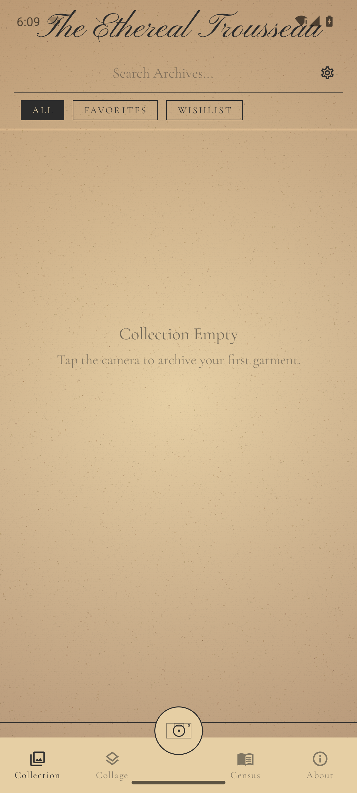
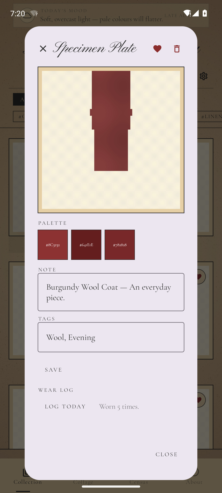
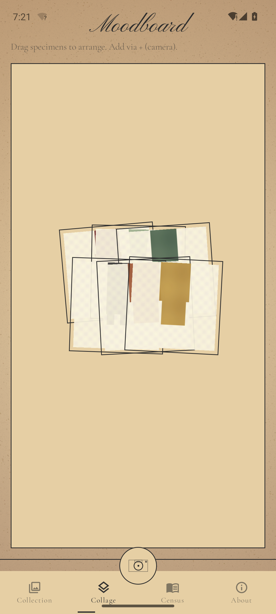
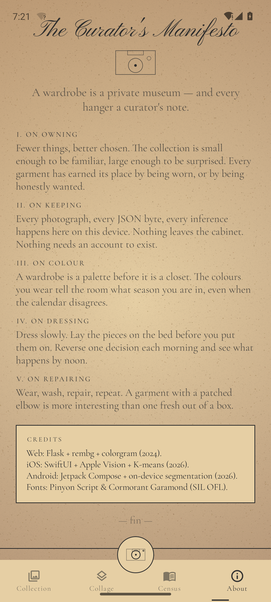
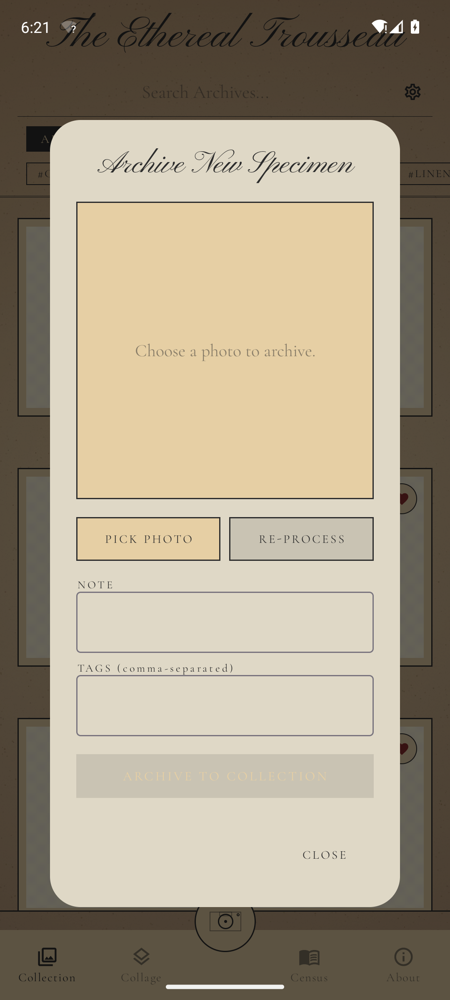
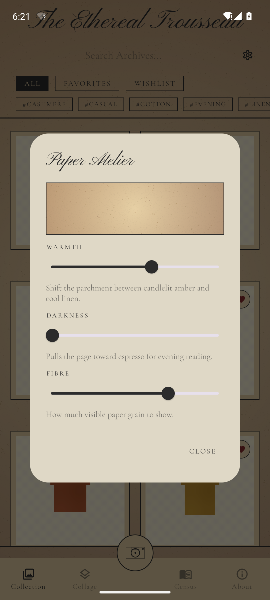

# The Ethereal Trousseau · Android

A native Android port of [The Ethereal Trousseau](../README.md) — the local-first digital wardrobe. Same aesthetic, same workflow, **zero external APIs**, on-device background removal.

> The web version runs Flask + rembg + colorgram on your laptop.
> The iOS version runs SwiftUI + Apple's Vision framework on your phone.
> This Android version runs Jetpack Compose + MediaPipe Tasks on your phone.


## Build & run

Requirements: JDK 17, Android SDK with platform-tools and API 34, Gradle 8.7 (the wrapper downloads it on first run).

```bash
# from this directory
./gradlew :app:assembleDebug      # → app/build/outputs/apk/debug/app-debug.apk
./gradlew :app:assembleRelease    # → app/build/outputs/apk/release/app-release.apk

# install onto an attached device
adb install -r app/build/outputs/apk/release/app-release.apk
```

The release build is signed with the self-signed keystore at `app/release.keystore`. **Do not** ship this to the Play Store as-is — generate your own and update the password in `app/build.gradle.kts`.

APK is arm64-v8a only (~30 MB) — covers every flagship phone shipped since 2020.

## What it ships with

| Asset | Where it lives |
| --- | --- |
| `selfie_segmentation.tflite` (244 KB) | `app/src/main/assets/` |
| Pinyon Script, Cormorant Garamond (3 weights each) | `app/src/main/res/font/` |
| Adaptive launcher icon (parchment + Wardrobe vector) | `app/src/main/res/mipmap-*/` |

Everything else — the Compose UI, the K-means palette, the parchment backdrop, the JSON store — is source.

## What's where

```
app/src/main/java/com/ethereal/trousseau/
├── MainActivity.kt
├── TrousseauApplication.kt           ← singleton Application for utilities
├── components/                       ← text styles, paperPrint helper, WeatherBanner
├── models/                           ← @Serializable Specimen
├── services/
│   ├── BackgroundRemovalService.kt   ← MediaPipe ImageSegmenter wrapper
│   ├── ColorPaletteService.kt        ← hand-rolled K-means
│   └── WardrobeStore.kt              ← JSON-on-disk persistence
├── theme/                            ← palette, PaperBackdrop
└── views/
    ├── RootView.kt                   ← 4-tab scaffold + sliding indicator
    ├── GalleryView.kt                ← search, filters, card grid
    ├── AddSpecimenSheet.kt           ← photo picker → MediaPipe → preview
    ├── SpecimenDetailView.kt         ← AlertDialog with palette / tags / wear log
    ├── CollageCanvasView.kt          ← drag-to-arrange collage
    ├── CensusView.kt                 ← stats + daily pull-quote
    ├── ManifestoView.kt
    └── SettingsSheet.kt              ← paper temperature / darkness / texture
```

## How background removal works

Three iterations live in `BackgroundRemovalService.kt` (full history in the file's KDoc):

1. **v1** — classic edge sampling + flood fill. Works for garments on a flat background, fails on a real subject.
2. **v2** — ML Kit Subject Segmenter via GMS dynamic modules. Cleaner in theory, but the model has to be downloaded on first use — emulators without Play Store, AOSP builds, and offline devices see the raw photo.
3. **v3 (this)** — **MediaPipe Tasks Vision ImageSegmenter** with the bundled `selfie_segmentation.tflite`. On-device, fully offline, no GMS dependency.

The current pipeline:

```
Input bitmap
   │
   ▼  downscale to ≤ 1024 px max dim
   │
   ▼  ImageSegmenter.segment(MPImage)
   │       ─ outputs a 256×256 confidence ByteBuffer
   │
   ▼  flip + normalise (this model ships the mask inverted)
   │
   ▼  bilinear-upsample to source resolution
   │
   ▼  per-pixel alpha, gamma-corrected (γ=0.85)
   │
   ▼  paste on 800×800 parchment canvas at 85% scale, centred
```

Two knobs make the difference versus a naïve binary cut:

| Knob | Why |
| --- | --- |
| Soft alpha instead of `>0.5 ? 1 : 0` | threshold at confidence ~0.5 was the source of the "speckled" look — confidence in that band randomly flipped and produced isolated opaque/transparent dots. Treating the value as a feather cleans the silhouette. |
| Bilinear upsample instead of nearest-neighbour | nearest-neighbour turns each 4×4-pixel block into one value, so the silhouette becomes a staircase. Bilinear interpolates between samples — clean edges at native resolution. |

Result on the Lolita dress from the project README:

| Original | Cut-out |
| --- | --- |
|  |  |

## Screenshots

| | |
|---|---|
|  |  |
|  |  |
|  |  |
|  |  |
|  | |

## What to read next

- The family overview: [../README.md](../README.md)
- iOS counterpart: [../Trousseau-iOS/README.md](../Trousseau-iOS/README.md)
- Web counterpart: [../Trousseau-Ethereal/readme.md](../Trousseau-Ethereal/readme.md)